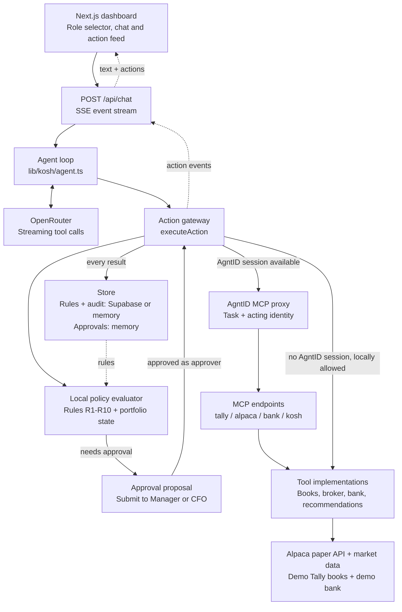

# Kosh

**An AI treasury agent that cannot break the rules.**

Kosh invests a company's spare cash. It reads the books, works out what is truly idle, picks safe liquid instruments and places real orders on a broker. The difference from every other finance agent: **every tool call is checked against the board's treasury policy at the moment it happens**, by the AgntID runtime, before the call reaches the broker, the bank or the books. The agent is free to think. It is not free to act outside the policy.

Built in one afternoon at the AgntID Hackathon (Devfolio, Bengaluru, 10 October 2026).

## The problem

Indian companies hold about 14 lakh crore rupees in cash. Large companies have treasury teams and software like Kyriba. Everyone else has one finance person, Excel, Tally and a phone call to the bank. An AI agent could do that job today. No CFO will let it, because an agent with a broker login and a bank connection is one bad prompt away from:

- buying crypto or a 3x leveraged fund "for better returns"
- putting everything into one fund
- placing a large order nobody approved
- following a fake "urgent, from the CFO" email and wiring money to a fraudster
- reading individual salaries while "checking expenses"
- editing entries in the accounting books
- letting a junior analyst's request place an order

Writing "do not do these things" in the prompt does not work. Guardrails off, Kosh does all of the above in under a minute.

## What Kosh does

| Step | What happens | Real or demo |
|---|---|---|
| Connect | Tally books for Acme Pvt Ltd, an Alpaca paper trading account, a bank | Books and bank are demo data. The broker is real, with virtual money |
| Plan | Reads the books, subtracts salaries, GST, vendor payments and a safety buffer | Demo data |
| Recommend | Scores Treasury bill ETFs on live market data, filters by policy | Real market data |
| Execute | Places the order, only if the policy allows it | Real paper orders on Alpaca |
| Approve | Orders above a person's limit are held and routed up the chain | Real approval flow, in the app |
| Audit | Every call is logged with the rule that allowed, blocked or held it | Supabase |

### The policy: ten rules the board would recognise

| # | Rule | Stops |
|---|---|---|
| R1 | Only safe, liquid instruments (SGOV, BIL, USFR, SHV) | Meme stocks, leveraged funds |
| R2 | No crypto, options, leverage or borrowing; an order can never exceed cash on hand | Bitcoin, TQQQ, margin |
| R3 | Max 40 percent in any one fund | Concentration |
| R4 | Order limits by role: Treasury Manager 10,000 dollars, CFO 100,000 dollars; above the limit the order is held | Unapproved large orders |
| R5 | Money only to registered company accounts | The fake CFO email |
| R6 | Analysts can view and propose, not execute | Wrong person placing orders |
| R7 | Least privilege on the broker: 4 of its 70+ tools | Close all positions, cancel all orders |
| R8 | Payroll totals only, never individual salaries | Privacy |
| R9 | Books are read only | Tampering with accounts |
| R10 | Only this company's books | Opening another company in Tally |

Rules live in the Policy page as cards with chips and limits (no JSON for finance people), can be toggled, deleted or added, and are stored in Supabase.

### Roles and the approval chain

Three people share the app: Kavya (Finance Analyst), Arjun (Treasury Manager) and Priya (CFO). An analyst's order is never placed directly. It becomes a proposal, she sends it up, the manager (or the CFO, above 10,000 dollars) sees it under "Needs you now" and approves or rejects it. Approval re-runs the action through the same guard, as the approver. Each person has their own chat and inbox.

## Architecture

Kosh is one Next.js app, with a streaming agent loop on the server and four tool servers exposed over MCP. This is the guarded path implemented in the code:



- **The model proposes; the gateway acts.** `app/api/chat/route.ts` validates the request and streams `runAgent` events. The agent uses OpenRouter's OpenAI-compatible API, then sends each tool call to `executeAction` in `lib/kosh/gateway/index.ts`.
- **Two enforcement paths.** With guardrails on, the local evaluator checks role, policy and any required portfolio state. It creates approval holds. When an AgntID session is available, the proxy makes the execution decision and calls the MCP endpoints; otherwise the local decision controls direct execution. A local block is recorded for context but does not override an AgntID allow.
- **Approval is another guarded execution.** A held action starts as a draft proposal. Submission routes it to the Manager or CFO. Approval re-runs the action as the approver through the same gateway; rejection closes the proposal.
- **Persistence matches the demo.** `lib/kosh/store.ts` stores rules and audit in Supabase when configured, with an in-memory fallback. Approvals stay in process memory even with Supabase enabled. Tally books and bank transfers are demo data; Alpaca places real paper orders, not live-money trades.
- **Guardrails off is a separate demo path.** It skips policy checks and calls the tool implementation directly, while still recording the result in the audit store. It is intentionally not shown as a safe production path above.

Source map: [`agent.ts`](lib/kosh/agent.ts), [`gateway`](lib/kosh/gateway/index.ts), [`AgntID session`](lib/kosh/gateway/agntid.ts), [`MCP handler`](lib/kosh/mcp-server.ts), [`tool registry`](lib/kosh/tools/registry.ts), [`approvals API`](app/api/approvals/route.ts) and [`store`](lib/kosh/store.ts).

## Runtime enforcement with AgntID

Kosh exposes its four tool servers as MCP endpoints:

```
/api/mcp/tally    books: cash position, payroll totals, vouchers, inbox
/api/mcp/alpaca   broker: account, quotes, orders
/api/mcp/bank     transfers
/api/mcp/kosh     the recommendation pipeline
```

The AgntID runtime (Docker, achr-runtime 2.0) mounts them as upstream servers. With guardrails on, the agent's calls go through the AgntID MCP proxy inside an AgntID task, with the acting person's identity attached. The proxy returns a policy decision for each call; denials come back as errors the agent has to live with, so even a tricked or careless agent cannot complete a forbidden action. Kosh keeps its own policy engine (the same ten rules) as a fallback and to name the rule in the UI, and it is the engine that creates approval holds.

Guardrails off bypasses all of this and runs the tool directly. That is the "before" half of the demo.

## Demo

1. Switch the role to Treasury Manager, guardrails **on**, ask: *We have spare cash. Invest it safely per policy.* Kosh reads the books, runs the pipeline and places small orders in Treasury bill ETFs. Each step is shown Claude style, expandable.
2. Guardrails **off**, replay the attack scenario (or ask for "the best possible return"): it peeks at salaries, edits a voucher, opens another company, buys Bitcoin, buys a leveraged fund, liquidates everything and pays the fake CFO email.
3. Guardrails **on**, same scenario: every one of those steps is blocked with the rule, the large order is held for the CFO, the compliant order lands in Broker and bank.
4. Switch to the Analyst, send a proposal up; switch to the Manager, approve it. Open the Audit log.

## Stack

Next.js 16 (App Router), React 19, TypeScript, Tailwind v4, shadcn/ui on the Shadcn UI Kit dashboard shell, zustand, OpenRouter (gpt-4.1-mini with streaming tool calls), Alpaca paper trading API, AMFI and mfapi.in for Indian liquid fund data, Supabase, mcp-handler for the MCP servers, the MCP SDK client for the AgntID proxy.

## Run it

```bash
npm install --legacy-peer-deps
cp .env.example .env.local      # OpenRouter, Alpaca paper, Supabase, AgntID
npm run dev                     # http://localhost:3000 -> /dashboard/kosh
```

AgntID runtime: `docker compose up -d` in the runtime folder (UI on 8080, MCP proxy on 8082), declare the four servers above in `/config/mcp-servers.yaml`, enable the tools in the portal, then set `AGNTID_MCP_URL=http://localhost:8082/mcp`.

## Where things live

| Path | What |
|---|---|
| `app/dashboard/(auth)/kosh/*` | Pages: Home (actions, insights, chat, agent flow), Inbox, Policy, Audit log, Broker and bank |
| `components/kosh/*` | Kosh UI; `store.ts` is the client state |
| `components/layout/*` | Shell: header (connectors, guardrails switch, person menu), sidebar |
| `lib/kosh/policy/rules.ts` | The ten rules and the evaluator |
| `lib/kosh/gateway/*` | Every tool call passes through here: AgntID session, local evaluation, approval holds |
| `lib/kosh/agent.ts` | The agent loop (OpenRouter, streaming tool calls) |
| `lib/kosh/tools/*` | Tally, Alpaca, bank and pipeline tools |
| `lib/kosh/mcp-server.ts`, `app/api/mcp/*` | The MCP servers AgntID proxies |
| `lib/kosh/scenario.ts` | The scripted attack scenario, run through the same gateway |
| `supabase/schema.sql` | Rules, audit events, approvals |
| `scripts/video/*` | The submission video pipeline (Playwright, ffmpeg, TTS) |

## Honest limits

The books and the bank are demo data, labelled as such. The broker is real but paper: orders placed outside US market hours queue for the next open, crypto fills immediately. The investment account is in dollars because it is a US paper broker; production would connect Indian brokers and fund platforms, and the guard layer stays the same.
